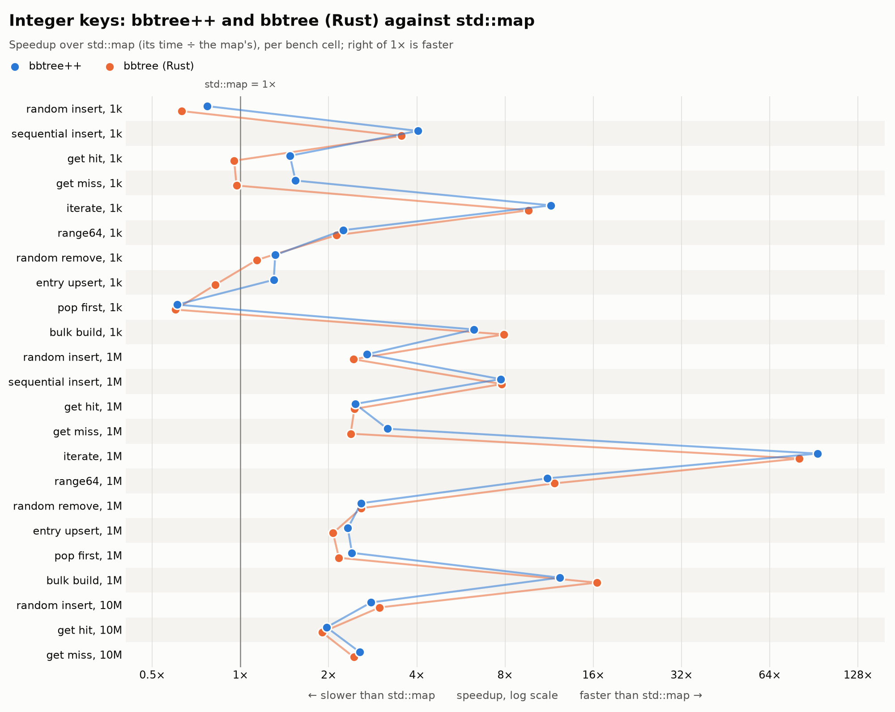
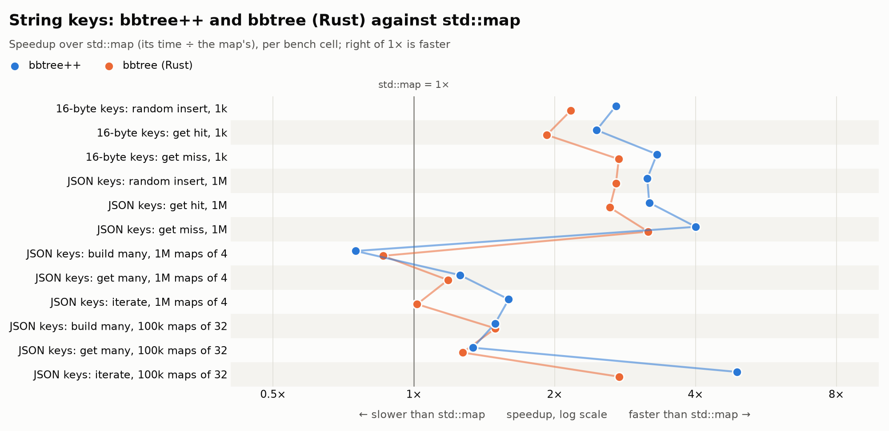

# Charts

Speedup charts of bbtree++ and bbtree (Rust) against `std::map`, a row per
bench cell: each dot sits at `std::map`'s time divided by the map's, on a
log axis, so right of 1× is faster.

| file | data |
|---|---|
| `integer_keys.csv`, `integer_keys.png` | COMPARISON.md, "Integer keys" |
| `string_keys.csv`, `string_keys.png` | COMPARISON.md, "String keys": bbtree++ with the compact string fastest on each cell, named in the CSV |





The main README shows the 1M-entry cells only (`integer_keys_1m.png`,
`string_keys_1m.png`).

The CSVs hold the tables' figures, nanoseconds per operation (iterate and
many maps: per entry). Regenerate the charts with
[uv](https://docs.astral.sh/uv/), which fetches matplotlib for the script:

```bash
T=bbtree/bench/tools/speedup_chart.py C=bbtree/bench/charts
uv run $T $C/integer_keys.csv --title "Integer keys: bbtree++ and bbtree (Rust) against std::map"
uv run $T $C/string_keys.csv --title "String keys: bbtree++ and bbtree (Rust) against std::map"
uv run $T $C/integer_keys.csv --1m --title "Integer keys, 1M entries: bbtree++ and bbtree (Rust) against std::map"
uv run $T $C/string_keys.csv --1m --title "String keys, 1M entries: bbtree++ and bbtree (Rust) against std::map"
```

PNGs are 2000 pixels wide; `--svg` writes SVG instead.
`--1m` keeps only the cells of one map of 1M entries and writes
`<csv name>_1m.png`; `--baseline` picks another column to compare with.
